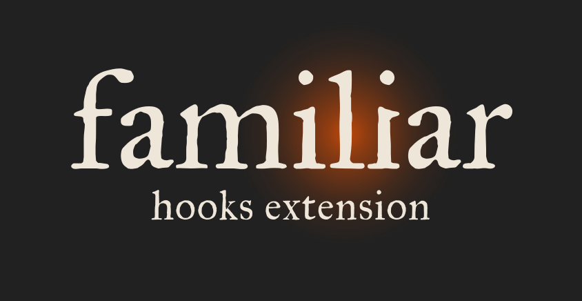

  

# familiar-hooks

Optional hooks for a [familiar](https://github.com/familiar-md/familiar) project or
[familiar-hub](https://github.com/familiar-md/familiar-hub), chosen one at a time. Nothing is on by default.

- **Session titles.** Claude Code names each session after its project, `(<signature>) <project name>`,
  so the session list on your phone or the web shows which project is which.
- **Guards.** familiar keeps the assistant to the project by instruction. The guards check each file and
  shell tool call before it runs, and deny a write outside the project, into `1-Inputs/` or into
  `.familiar/`, a read outside the project, or a delete.
- **Checks.** After a file is written, they flag a truncated Office file, a misnamed draft or a missing
  citation field, so the assistant can fix it in the same turn.

The guards are a deterrent, not a security boundary: they read the tool call's text, so a script run
through an interpreter can get past them. Every hook starts Python around ordinary activity, which can
trip endpoint protection or script policy on managed work hardware, so check before installing there.
familiar works fully without any of this.

## Per project, by choice

Hooks are installed per project, so each project gets only the ones it needs: strict guards on a
confidential engagement, just the session title on a personal one. The hub cannot apply hooks for its
projects, because your assistant loads hooks from the folder it is opened in.

## Start

1. Download `familiar-hooks-<version>.zip` from
   [Releases](https://github.com/familiar-md/familiar-hooks/releases) and unzip it.
2. Copy the `.familiar` folder inside it onto your project folder. It adds `.familiar/hooks/` beside
   what is already there and changes nothing else. (`.familiar` is a hidden folder: show hidden files
   if you cannot see it.)
3. In the project, run `/ili-system-settings` → Hooks (Claude Code) or `/system-settings` → Hooks. The
   assistant lists the hooks, asks which you want, shows what will change and installs only after your
   yes. Then restart the session.

Repeat for each project that should have hooks. To install by hand instead, see
[`INSTALL-HOOKS.md`](INSTALL-HOOKS.md).

## Read next

- [`INSTALL-HOOKS.md`](INSTALL-HOOKS.md): installing per host, by hand, verifying, removing.
- [`MANUAL-HOOKS.md`](MANUAL-HOOKS.md): what each hook decides, what a denial looks like, the limits.

Hooks belong to the agent harness, not the model: they run the same whichever model the harness uses.
Tested with Claude Code. The installer also writes Codex's hook file; Gemini CLI needs the hooks added
by hand, and other harnesses may have no hooks at all.

Apache 2.0, like familiar core. See [`LICENSE`](LICENSE).
